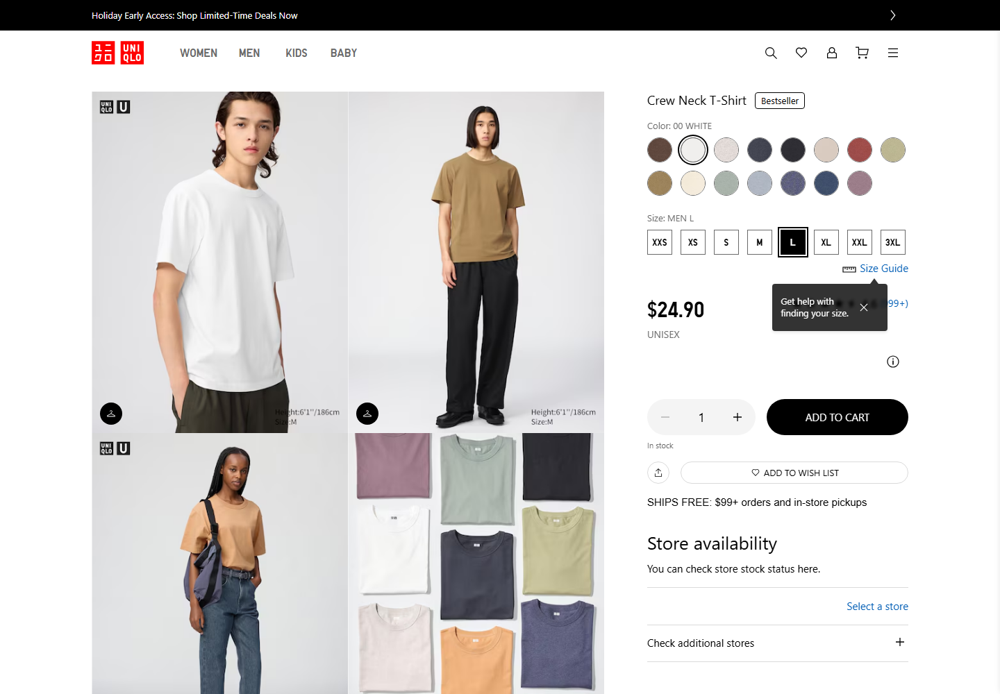
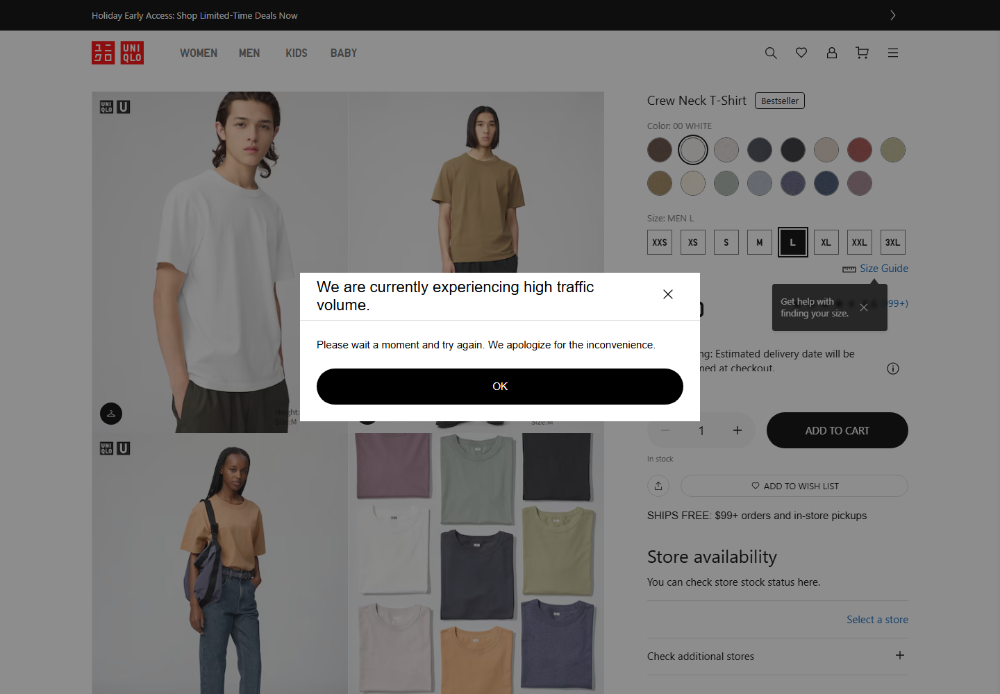
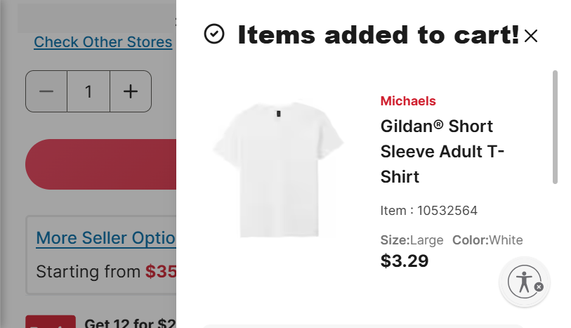
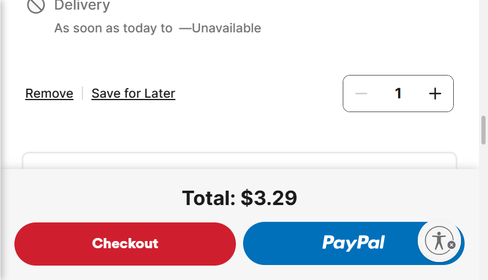
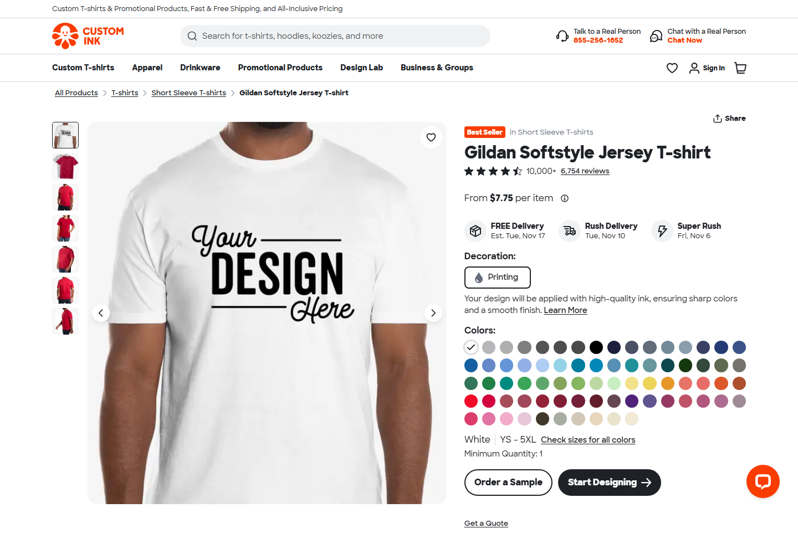
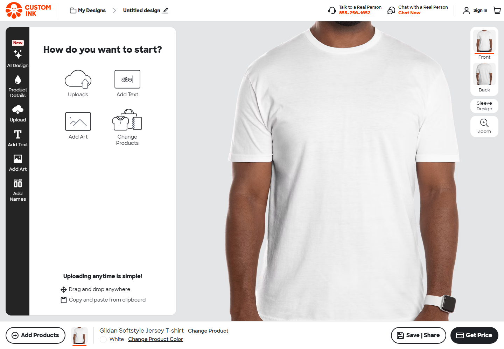
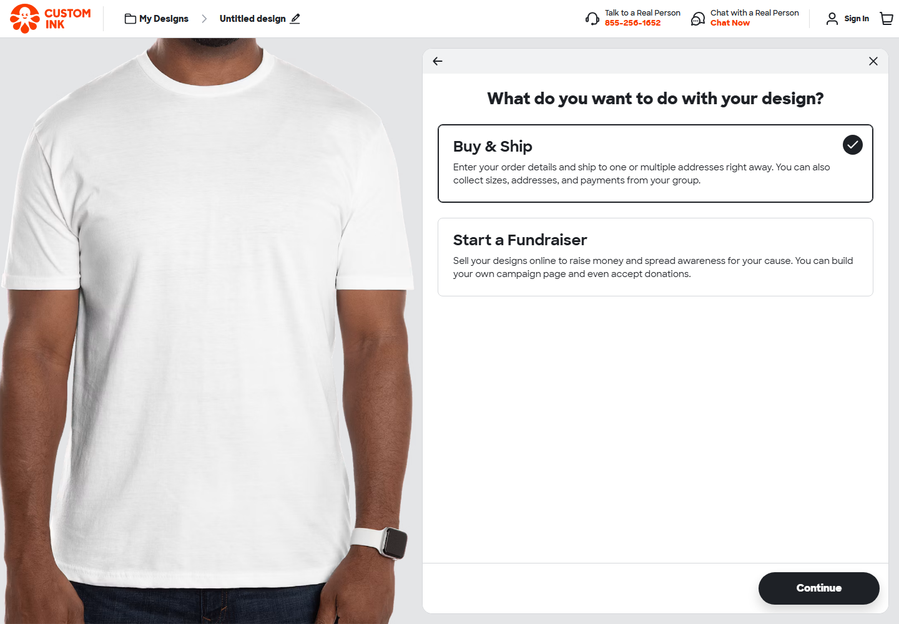
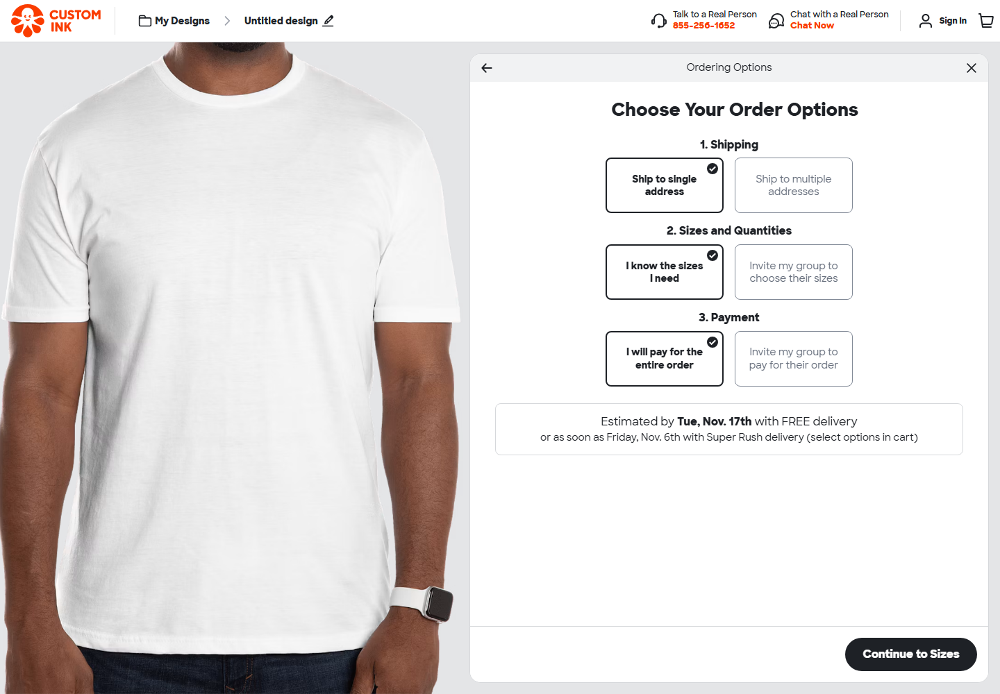
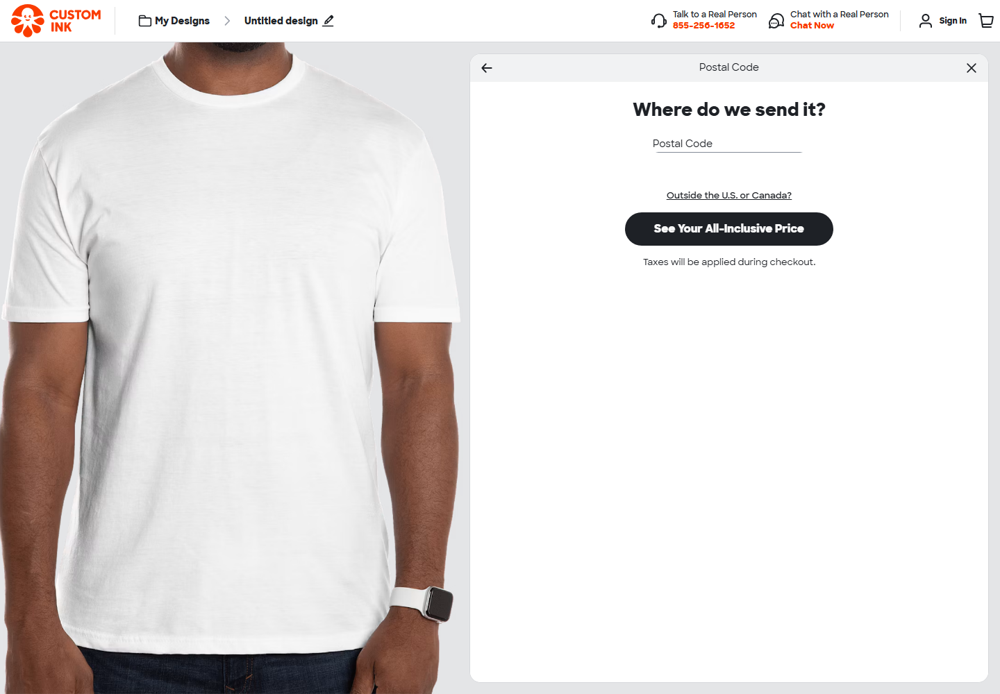

# U.S. White T-Shirt Competitive Landscape

**Research capture:** November 3, 2026

**Scope:** U.S.-facing websites and one-item buying paths for the same basic white T-shirt. This is a small, observed comparison—not a market-size study, customer study, or completed purchase.

## Executive read

These four names occupy different parts of the market, so they are useful reference points rather than four interchangeable shirt brands:

- **UNIQLO** sells ready-to-wear apparel directly.
- **Michaels** is a craft retailer; the observed plain tee was a Gildan item sold by Michaels.
- **Custom Ink** sells decorated/customized apparel and guides buyers through a design and order-planning flow.
- **Gildan** is the blank-shirt brand on the Michaels listing. Its own U.S. site could not be inspected in this session, so the Gildan evidence here is retailer evidence only.

The clearest opening for a proposed “Blank Theory” is not simply to say that a white shirt is a canvas: Custom Ink already makes customization explicit, while Michaels offers a low-cost blank. A distinct offer would need to explain what the buyer can reliably do with this particular shirt, what is included, and what remains the buyer's own creative choice. Fabric, care, fit, and suitability for paint or markers must be verified before they are presented as product facts.

## How to read the lenses

The archetypes below are **interpretations of the observed offer and interface**, not archetypes the companies claim for themselves and not claims about their customers. Cialdini cues are visible interface features; their presence does not establish a company's intent or prove a sales effect. “Modernist” and “postmodernist” describe design tendencies, not a binary style test. The V&A describes Modernism through function, clarity, and reduced ornament, and Postmodernism through such ideas as complexity, contradiction, theatricality, and self-aware style. These terms are used as cautious comparisons, not as labels the companies use.

## Comparison

| Competitor and role                                         | Archetype lens (interpretive)                                                                                                                                                                            | Persuasion cues observed                                                                                                                                                                                                                                                                                                                                   | Visual design reading                                                                                                                                                                                                                                                                                                                                                    |
| ----------------------------------------------------------- | -------------------------------------------------------------------------------------------------------------------------------------------------------------------------------------------------------- | ---------------------------------------------------------------------------------------------------------------------------------------------------------------------------------------------------------------------------------------------------------------------------------------------------------------------------------------------------------- | ------------------------------------------------------------------------------------------------------------------------------------------------------------------------------------------------------------------------------------------------------------------------------------------------------------------------------------------------------------------------ |
| **UNIQLO — direct apparel retailer**                        | **Everyman:** the product is presented as an everyday wardrobe basic, with a large color and size selection. This is a reading of the product page, not an official brand claim.                         | The product page displayed a “Bestseller” label and a rating/review count. These are social-proof cues. A rating or label is not evidence that the shirt fits a particular buyer.                                                                                                                                                                          | **Modernist-leaning tendencies:** a product-first grid, restrained interface, repeated color swatches, clear size controls, and a prominent price/action. Model and folded-shirt imagery add styling context, but the interface still organizes attention around choosing a variant. This is not a claim that the site belongs to the Modernist movement.                |
| **Michaels — craft retailer and seller of a Gildan blank**  | **Creator:** the blank tee can function as a material for a project. The retailer context supports this interpretation more than the shirt's own branding does.                                          | A sale-code banner was visible, but a promotion alone is not enough to assign a Cialdini principle. No sales lift, scarcity, or customer motivation was measured.                                                                                                                                                                                          | **Functional catalog with promotional layering:** categories, search, product filters, and cart controls help shoppers find an item; banners and overlays compete for attention. The organization is practical, while the stacked retail promotions create a busier surface. There is not enough evidence to call that Postmodernism.                                    |
| **Custom Ink — customized apparel and group-order service** | **Creator:** the Design Lab makes adding text, art, names, and uploads central to the offer. Group/fundraiser paths add a community use case without changing the product into a different shirt brand.  | The product page showed “Best Seller,” a review count, and “10,000+” alongside the rating. Those are social-proof signals in the captured state. Choosing to create a design before continuing may be a **possible** consistency mechanism, because the visitor has voluntarily invested effort; this is an interpretation, not proof of intent or effect. | **Structured tool, open-ended result:** the designer uses a controlled panel and step-by-step order choices, while the artwork visitors create can combine many visual languages. The interface itself is mainly functional; user customization makes varied outcomes possible. That distinction is more useful than calling the site simply modernist or postmodernist. |
| **Gildan — blank-shirt brand shown through Michaels**       | **Everyman (tentative):** the retailer listing presents a plain, low-priced basic. The evidence supports a reading of the item in this channel, not a conclusion about Gildan's complete brand identity. | No Gildan-owned persuasion cue was assessed. The “Best Seller” and rating signals on Custom Ink belong to Custom Ink's product page, not to Gildan's direct site.                                                                                                                                                                                          | The Michaels product/cart images show a plain tee and practical purchase controls. They document **Michaels's presentation of a Gildan product**, not Gildan's own web design. Gildan's direct U.S. site returned access denied/403 and was not reviewed.                                                                                                                |

## Buying paths observed

### UNIQLO

The earlier U.S. product capture was the men's Crew Neck T-Shirt: it showed a white color option, sizes from XXS through 3XL, model/product imagery, a **$24.90** price, and an Add to Cart action. The page also displayed a Bestseller label and rating/review information. On the attempted add-to-cart action, the site returned a “currently experiencing high traffic volume” message. A cart or checkout was therefore **not reached**.

In a follow-up live browser review on the same date, the U.S. site’s [women's Crew Neck T-Shirt, product ID 483456](https://www.uniqlo.com/us/en/products/E424873-000/00?colorDisplayCode=00) showed white, sizes XXS–XXL, **$19.90**, and a 4.7 rating with 999+ reviews. The product page also presented a size guide, shipping information, and store-availability controls. A text-message signup overlay initially obscured the page; no signup was completed. This is a different product listing from the men's screenshot, not evidence that the earlier $24.90 price changed.

_Product controls and presentation were visible. The shipping/location line is masked because the page had a location prefilled by the browser._

_This is an observed interruption, not evidence that UNIQLO checkout is generally unavailable._

### Michaels: Gildan Short Sleeve Adult T-Shirt

The Michaels search results reported **2,584 products** for “blank t-shirt” and exposed filters including Michaels, Gildan, and White. The observed listing was item **10532564**, Gildan Short Sleeve Adult T-Shirt, white, size Large. Adding one item displayed a **$3.29** price in the cart. The cart showed a $3.29 subtotal/total and Checkout and PayPal controls.

_The local store-availability line has been masked. The screenshot documents Michaels's listing and cart confirmation, not a Gildan-owned store._

_Checkout opened an account/guest choice, but the next browser state was the cart again and the checkout did not advance further in this session. No shipping address or payment details were entered, and no order was placed. The final checkout steps remain unobserved._

### Custom Ink: Gildan Softstyle Jersey T-shirt

The product page showed a white option, a displayed starting price of **$7.75 per item**, a minimum quantity of one, a “Best Seller” label, and review information. These are captured page values, not a guaranteed quote or a like-for-like comparison with the unprinted retail shirts.

The Design Lab presented upload, text, art, and product-changing tools around a blank-shirt preview. The next steps offered **Buy & Ship** or **Start a Fundraiser**, then choices for one or multiple shipping addresses, known sizes or collecting sizes from a group, and paying for the whole order or inviting the group to pay. This is an order-planning flow with collaboration options, not a completed checkout.

The quote path asked for a postal code before showing an all-inclusive price. A value had been prefilled in the field by the site/browser; it is masked below and was **not submitted**. No address or payment information was provided.

## Price and offer snapshot

| Observed offer                               |    Captured display | Important qualification                                                                 |
| -------------------------------------------- | ------------------: | --------------------------------------------------------------------------------------- |
| UNIQLO men's Crew Neck T-Shirt (screenshot)  |              $24.90 | Ready-to-wear retail page; add-to-cart attempt was interrupted.                         |
| UNIQLO women's Crew Neck T-Shirt (live page) |              $19.90 | Product ID 483456; follow-up page review; no add-to-cart attempt.                       |
| Michaels Gildan Short Sleeve Adult T-Shirt   |               $3.29 | One white, size-L item in a retailer cart; final shipping/tax checkout was not reached. |
| Custom Ink Gildan Softstyle Jersey T-shirt   | From $7.75 per item | Customization flow; final quote depends on order details and a postal code.             |

These are page snapshots from different offers and buying models, not a controlled price comparison. Prices, ratings, delivery dates, stock, and page content can change.

## Follow-up streetwear fit reference

This follow-up is separate from the four-brand comparison above. In the Stüssy U.S. [Derby Tee - White product page](https://www.stussy.com/collections/tees/products/1905206-derby-tee-white), the product details call the shirt a “Relaxed fit shortsleeve tee.” The adjacent Size Guide states that measurements are taken across the garment while laid flat and lists chest, length, and sleeve measurements by size. This is one example of making the fit description and measurement method available near size selection.

The page says “relaxed fit,” not “boxy,” and describes a different shirt. It does not establish a general streetwear convention or verify the learner's proposed shirt, fit, or measurements. Use it as a reference for clear size guidance only.

## What this suggests for Blank Theory

1. **Make the actual offer unmistakable.** UNIQLO sells a wearable basic; Michaels sells a blank at retail; Custom Ink sells a way to design printed apparel. If Blank Theory sells only the plain shirt, do not imply that painting supplies, printing, or a paint-ready finish are included.
2. **Answer the primary audience's real question with evidence.** The learner's idea is that a buyer may want to write or paint on the shirt. Verify the fabric, care instructions, and compatibility with specific materials before making that promise; otherwise say the answer is not yet verified.
3. **Turn the blank into a meaningful choice, not an unsupported claim.** A clear explanation of what is known, what is included, and how the buyer can make the shirt their own could distinguish the page from basic product catalogs without pretending to offer Custom Ink's design service.
4. **Use persuasion to clarify, not pressure.** The competitors show that ratings, popularity labels, and promotions are common interface signals. A new brand should use only substantiated proof, avoid invented scarcity or testimonials, and make price and product limitations easy to understand.

These are design opportunities to consider, not evidence of customer demand or a recommendation to build checkout now.

## Sources and limits

- [UNIQLO U.S. store](https://www.uniqlo.com/us/en/) and [women's Crew Neck T-Shirt, product ID 483456](https://www.uniqlo.com/us/en/products/E424873-000/00?colorDisplayCode=00) — product-page observations from the U.S. storefront; the men's product-specific URL was not retained with the original screenshot.
- [Michaels U.S. search for “blank t-shirt”](https://www.michaels.com/search?q=blank%20t-shirt) — retailer search and cart observations.
- [Custom Ink products](https://www.customink.com/products/) — Gildan Softstyle product and design/order flow observations.
- [Stüssy Derby Tee - White](https://www.stussy.com/collections/tees/products/1905206-derby-tee-white) — follow-up observation of fit wording and garment-flat size measurements; not part of the four-brand comparison.
- [Gildan U.S. site](https://www.gildan.com/) — access returned 403 in this session; no direct Gildan product page or checkout was assessed.
- Robert Cialdini's [Seven Principles of Persuasion](https://www.influenceatwork.com/7-principles-of-persuasion/) — reference for naming persuasion principles, not evidence about competitor intent.
- Victoria and Albert Museum: [What was Modernism?](https://www.vam.ac.uk/articles/what-was-modernism) and [What is Postmodernism?](https://www.vam.ac.uk/articles/what-is-postmodernism) — historical design context.

Screenshots are local records of the observed pages, not evidence that every checkout state was completed. Some location or prefilled postal-code details have been masked. No purchase was made, and no personal or payment information was entered. The sites and checkout flows may change after the capture date.
